# 💰 Project-6 AWS Cost Optimization Plan
**Project:** Vinayaka Chavithi Chandas Collection & Real-Time Audit Platform  
**Target Region:** AWS ap-south-1 (Mumbai)  
**Architecture:** Multi-Tenant React SPA + Node.js/Socket.io API + PostgreSQL 16 + ECS Fargate / ALB  

---

## Executive Summary

Project-6 is a **multi-tenant festival donation and audit platform**. Its real-world workload profile is **deeply seasonal**: it experiences concentrated, bursty traffic for **10–14 days per year** during the festival season (mornings and evenings), followed by **11 months of near-zero traffic or archival read-only access**.

Under the current baseline architecture provisioned in `approach_1_ecs/terraform/`, the infrastructure incurs a steady-state burn of **~$101 – $142 / month ($1,212 – $1,704 / year)** even when completely idle, primarily driven by static infrastructure overheads (AWS NAT Gateway, Application Load Balancer, always-on Multi-AZ RDS, and Fargate on-demand tasks).

By implementing the 4-phase optimization strategy detailed below, monthly steady-state costs are reduced by **70% to 92%**, bringing ongoing operational expenses down to **$8 – $25 / month**, with the option for **$0 / month** off-season archival.

```mermaid
flowchart LR
    subgraph Current["Current Baseline (~$101/mo)"]
        NAT["NAT Gateway: $32.85"]
        ALB["ALB: $18.00"]
        ECS["2x Fargate: $18.02"]
        RDS["RDS Postgres: $15.44"]
        Redis["ElastiCache: $12.41"]
        Other["Secrets/Logs: $4.45"]
    end

    subgraph Optimized["Optimized Fargate (~$28/mo)"]
        NoNAT["No NAT (Public Subnet + SG): $0"]
        ALBOpt["ALB (Active Festival): $18.00"]
        Spot["1 On-Demand + Spot: $8.40"]
        RDSOpt["RDS t4g.micro (gp3): $15.44"]
        SSM["SSM Parameter Store: $0"]
        Logs["CloudWatch 7d + ECR Rule: $1.00"]
    end

    subgraph OffSeason["Off-Season Hibernation (<$2/mo)"]
        S3Dist["S3 + CloudFront: $0.10"]
        DBDump["Encrypted S3 DB Backup: $0.05"]
        ComputeZero["Compute Scaled to 0: $0"]
        ALBPause["ALB Deleted/Deregistered: $0"]
    end

    Current -->|Immediate Fixes| Optimized
    Optimized -->|Post-Festival Shutdown| OffSeason
```



---

## 1. Baseline Cost Analysis (Current Architecture)

An audit of the Terraform files (`vpc.tf`, `ecs.tf`, `rds.tf`, `alb.tf`, `secrets.tf`, `s3_cloudfront.tf`) reveals the following cost drivers:

| Component | AWS Resource | Current Configuration | Estimated Monthly Cost (ap-south-1) | % of Total Bill |
|---|---|---|---|---|
| **Outbound Egress** | `aws_nat_gateway` | 1x NAT Gateway (`single_nat_gateway = true`) | **$32.85** ($0.045/hr) + Data ($0.045/GB) | **32.5%** |
| **Load Balancing** | `aws_lb` | 1x Application Load Balancer + Listeners | **$18.00** ($0.0225/hr + LCU baseline) | **17.8%** |
| **Backend Compute** | `aws_ecs_service` | 2x Fargate tasks (0.25 vCPU, 0.5 GB RAM) 24/7 | **$18.02** (On-Demand pricing) | **17.8%** |
| **Database** | `aws_db_instance` | PostgreSQL 16 `db.t4g.micro`, 20GB gp3 | **$15.44** ($13.14 instance + $2.30 storage) | **15.3%** |
| **WebSocket Cache** | `aws_elasticache_cluster` | Redis `cache.t4g.micro` (documented architecture) | **$12.41** ($0.017/hr) | **12.3%** |
| **Secrets Storage** | `aws_secretsmanager_secret` | AWS Secrets Manager (1 secret + API calls) | **$0.45** ($0.40/secret/mo + API calls) | **0.4%** |
| **Observability & Logs** | `aws_cloudwatch_log_group` | 14-day retention, container logs | **$2.50** ($0.50/GB ingested) | **2.5%** |
| **Container Registry** | `aws_ecr_repository` | Unbounded image retention (no lifecycle policy) | **$1.00** (Growing continuously) | **1.0%** |
| **DNS & Edge** | Route 53 + CloudFront + S3 | Hosted zone + CloudFront OAC + S3 SPA | **$0.50** (CloudFront 1TB Free Tier) | **0.5%** |
| **TOTAL** | | | **~$101.17 / month** | **100%** |

*(Note: If configured with Multi-AZ RDS `db.t4g.small` as outlined in Tier 2 documentation, monthly costs increase to **~$142.00 / month**).*

---

## 2. Strategic Cost Optimization Pillars

### Pillar 1: High-Impact Infrastructure Right-Sizing

#### 1. Eliminate NAT Gateway ($32.85/month Savings — 100% NAT Cost Reduction)
* **Root Cause:** ECS Fargate tasks are hosted in private subnets without public IPs, requiring a NAT Gateway solely to make outbound connections to Amazon ECR (image pull), Secrets Manager, and CloudWatch.
* **Solution (Recommended):**
  1. Move ECS Fargate task placement to public subnets (`subnets = aws_subnet.public[*].id`).
  2. Set `assign_public_ip = true` in `aws_ecs_service`.
  3. Enforce **Zero-Trust Ingress** in `aws_security_group.ecs`: Allow port 5000 ingress **ONLY** from the security group of the ALB (`security_groups = [aws_security_group.alb.id]`). Disallow any direct internet access to port 5000.
  4. Outbound internet egress now uses the free AWS Internet Gateway (`aws_internet_gateway.gw`).
* **Cost Impact:** Drops monthly networking fee from **$32.85 to $0.00**.

#### 2. Replace Secrets Manager with SSM Parameter Store ($0.45/month Savings)
* **Root Cause:** AWS Secrets Manager costs $0.40/secret/month plus per-call API charges.
* **Solution:** Migrate secrets (`DATABASE_URL`, `JWT_SECRET`, `DB_PASSWORD`) to **AWS Systems Manager (SSM) Parameter Store** Standard Tier.
  - Standard Parameter Store is **100% FREE** for up to 10,000 parameters.
  - Supports `SecureString` with AWS KMS encryption at no additional charge.
  - ECS Task Definitions natively inject SSM parameters via `valueFrom`:
    ```json
    {
      "name": "DATABASE_URL",
      "valueFrom": "arn:aws:ssm:ap-south-1:123456789012:parameter/chandas/DATABASE_URL"
    }
    ```
* **Cost Impact:** $0.45/mo ➔ **$0.00/mo**.

#### 3. Transition ECS Compute to Fargate Spot (Up to 70% Compute Savings)
* **Root Cause:** Tasks currently run on 100% Fargate On-Demand.
* **Solution:** Implement an ECS Capacity Provider Strategy combining baseline reliability with Spot cost savings:
  - **Base = 1 on FARGATE (On-Demand):** Guarantees at least 1 persistent container is never interrupted.
  - **Weight = 3 on FARGATE_SPOT:** Additional scale-out tasks run on spare AWS capacity at a 70% discount.
  ```hcl
  capacity_provider_strategy {
    capacity_provider = "FARGATE"
    weight            = 1
    base              = 1
  }
  capacity_provider_strategy {
    capacity_provider = "FARGATE_SPOT"
    weight            = 3
    base              = 0
  }
  ```
* **Cost Impact:** During off-peak, run 1 single task at $9.01/mo. During peak, 1 On-Demand + 2 Spot tasks cost only **$14.41/mo** instead of **$27.03/mo**.

#### 4. Enforce ECR Lifecycle Policy & CloudWatch Retention
* **Root Cause:** Without a lifecycle policy in `ecs.tf`, every Docker push stores a new ~200MB layer image on S3 indefinitely.
* **Solution:** Add an automated ECR lifecycle policy to retain only the last **3 tagged images** and expire untagged images after **1 day**:
  ```hcl
  resource "aws_ecr_lifecycle_policy" "server_policy" {
    repository = aws_ecr_repository.server.name
    policy     = jsonencode({
      rules = [
        {
          rulePriority = 1
          description  = "Expire untagged images after 1 day"
          selection    = { tagStatus = "untagged", countType = "sinceImagePushed", countUnit = "days", countNumber = 1 }
          action       = { type = "expire" }
        },
        {
          rulePriority = 2
          description  = "Keep only last 3 images"
          selection    = { tagStatus = "any", countType = "imageCountMoreThan", countNumber = 3 }
          action       = { type = "expire" }
        }
      ]
    })
  }
  ```
* CloudWatch log retention should be trimmed from 14 days down to **7 days** during non-audit periods.

---

### Pillar 2: Seasonal Lifecycle & Hibernation Management

Because Project-6 is an annual event platform, paying 12 months of 24/7 cloud costs for 2 weeks of utility is the single largest source of budget waste.

```
┌─────────────────────────────────────────────────────────────────────────────┐
│                           ANNUAL LIFECYCLE TIMELINE                         │
├──────────────────────────────┬──────────────────────────────────────────────┤
│  AUGUST - SEPTEMBER (30 Days)│          OCTOBER - JULY (11 Months)          │
│        FESTIVAL ACTIVE       │            OFF-SEASON HIBERNATION            │
├──────────────────────────────┼──────────────────────────────────────────────┤
│ • ECS Tasks: 2-4 (Fargate)   │ • ECS Tasks: Scaled to 0 ($0 compute)        │
│ • ALB: Active (Stickiness)   │ • ALB: Deleted or deregistered ($0 ALB)      │
│ • RDS: Online (Postgres 16)  │ • RDS: Final Snapshot taken, DB stopped     │
│ • CloudFront: Active Edge    │ • S3 Static Read-Only Archive ($0.05/mo)     │
│ Cost: ~$25 - $40 / month     │ Cost: ~$0.50 - $1.50 / month                 │
└──────────────────────────────┴──────────────────────────────────────────────┘
```

#### Automated Pre/Post-Festival Runbook

1. **Pre-Festival Ramp-Up (1 week before festival):**
   - Restore RDS from the latest automated snapshot (or start stopped RDS instance).
   - Terraform `apply` to bring up ALB and ECS tasks.
   - Run seed validation and test endpoints (`npm test`).
2. **Post-Festival Teardown (1 week after festival):**
   - Trigger pg_dump export and upload encrypted SQL backup to S3 Standard-IA (`s3://chandas-backups/2026/`).
   - Run `aws rds create-db-snapshot --db-instance-identifier chandas-postgres --db-snapshot-identifier chandas-postgres-final-2026`.
   - Scale ECS service to 0: `aws ecs update-service --cluster chandas-cluster --service chandas-service --desired-count 0`.
   - Tear down ALB and NAT gateway via Terraform workspace or flag: `terraform apply -var="enable_ingress=false"`.
   - **Annual Savings from Hibernation:** **~$800 – $1,200 per year saved!**

---

### Pillar 3: Architectural Alternatives Comparison

Depending on team preferences and infrastructure tolerance, here is how the optimized architecture compares against other deployment models:

| Option | Architecture | Monthly Active Cost | Off-Season Cost | Pros | Cons |
|---|---|---|---|---|---|
| **Option A (Tuned ECS)** | ECS Fargate Spot + Public SG + Single RDS + CloudFront (No NAT) | **~$28 – $35** | **~$1 – $2** | Retains current containerized IaC and CI/CD pipelines without rewriting code. | Requires running ALB during the active month. |
| **Option B (AWS App Runner)** | AWS App Runner + RDS Postgres + S3/CloudFront | **~$15 – $25** | **~$0.50** | Zero ALB needed (App Runner includes free managed HTTPS & load balancer). Scales to zero automatically. | Slower cold starts after long idle periods. |
| **Option C (Single Lightsail VPS)** | 1x AWS Lightsail (2 vCPU, 2GB RAM, 60GB NVMe) | **$10.00 flat** | **$10.00 flat** | Simplest operation (`docker compose up -d`). Predictable flat pricing. | Single point of failure; manual OS patching. |
| **Option D (Serverless Cloud)** | Vercel (Frontend) + Render/Fly.io (API) + Neon.tech (DB) | **$0 – $7** | **$0.00** | Free tier coverage; automated scale-to-zero. | Cross-cloud vendor fragmentation. |

**Strategic Choice:** **Option A (Tuned ECS)** is recommended for maintaining the existing production-grade Terraform codebase and CI/CD pipeline while slashing costs by 75%.

---

## 3. Terraform Implementation Changes

The following targeted Terraform edits implement these savings directly in `approach_1_ecs/terraform/`:

### A. Disable NAT Gateway (`terraform/variables.tf` & `vpc.tf`)
```hcl
variable "enable_nat_gateway" {
  description = "Set to false to eliminate NAT Gateway costs by using public subnet with zero-trust SG"
  type        = bool
  default     = false
}
```

### B. Configure Fargate Spot Capacity Provider (`terraform/ecs.tf`)
```hcl
resource "aws_ecs_cluster_capacity_providers" "main" {
  cluster_name = aws_ecs_cluster.main.name

  capacity_providers = ["FARGATE", "FARGATE_SPOT"]

  default_capacity_provider_strategy {
    capacity_provider = "FARGATE"
    weight            = 1
    base              = 1
  }

  default_capacity_provider_strategy {
    capacity_provider = "FARGATE_SPOT"
    weight            = 3
    base              = 0
  }
}
```

### C. Add ECR Lifecycle Rule (`terraform/ecs.tf`)
```hcl
resource "aws_ecr_lifecycle_policy" "server_cleanup" {
  repository = aws_ecr_repository.server.name

  policy = jsonencode({
    rules = [{
      rulePriority = 1
      description  = "Keep only latest 3 images"
      selection = {
        tagStatus   = "any"
        countType   = "imageCountMoreThan"
        countNumber = 3
      }
      action = { type = "expire" }
    }]
  })
}
```

---

## 4. FinOps Governance & Cost Anomaly Guardrails

1. **AWS Monthly Budget Alert:**
   - Budget amount: **$40.00 / month**.
   - Notifications: Alert when forecasted spending exceeds 80% ($32.00) or actual exceeds 100% ($40.00).
2. **AWS Cost Anomaly Detection:**
   - Deploy automated monitor linked to Slack / Email SNS topic detecting sudden spikes (e.g. runaway NAT egress or recursive API loops).
3. **Resource Tagging Standard:**
   ```hcl
   default_tags {
     tags = {
       Project     = "project-6"
       Application = "chandas-collection"
       Environment = var.environment
       ManagedBy   = "Terraform"
     }
   }
   ```

---

## 5. Cost Reduction Summary Matrix

| Metric | Before Optimization | After Optimization (Active Festival) | After Optimization (Off-Season) | Total Annual Savings |
|---|---|---|---|---|
| **Networking (NAT)** | $32.85 / mo | **$0.00 / mo** | **$0.00 / mo** | **$394.20** |
| **Compute (ECS)** | $18.02 / mo | **$8.40 / mo** | **$0.00 / mo** | **$207.84** |
| **Load Balancing (ALB)** | $18.00 / mo | **$18.00 / mo** | **$0.00 / mo** | **$198.00** |
| **Secrets Manager** | $0.45 / mo | **$0.00 / mo** | **$0.00 / mo** | **$5.40** |
| **Logs & Container Registry** | $3.50 / mo | **$1.00 / mo** | **$0.10 / mo** | **$39.50** |
| **Database (RDS)** | $15.44 / mo | **$15.44 / mo** | **$0.05 / mo (Snapshot)** | **$169.29** |
| **MONTHLY TOTAL** | **~$88.26 / mo** | **~$42.84 / mo** | **~$0.65 / mo** | — |
| **ANNUAL EXPENDITURE** | **~$1,059.12 / yr** | **—** | **—** | **~$914.23 / yr (86.3% Saved!)** |

*(Note: Calculated assuming 1 active festival month + 11 off-season months).*
